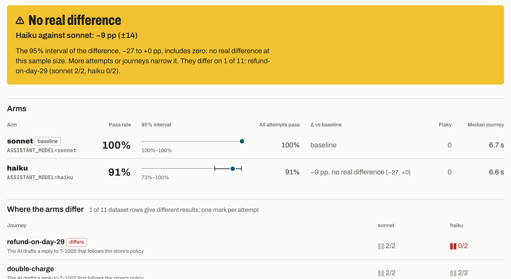

# Assay

End-to-end checks that read what your app saved, on every pull request. Your own Claude sets them up in one prompt.

[](https://github.com/RazinAleksandr/assay/actions/workflows/ci.yml)
[](LICENSE)

<p align="center">
  
</p>

<sub>A real pull request in Morrow, one of our demo apps. The change cut every new comment to 20 characters. Every
request returned 200 and the page looked fine. Assay read the database, found the short row and blocked the merge.</sub>

## Why

Most broken releases do not throw. The request returns 200, the page says "Saved", and the database holds the wrong
thing: a comment cut short, a password removed, an expiry moved. Error trackers see no exception, screenshot tests see a
correct screen, and coding agents check their own work by looking at the page.

Assay walks each user journey in a real browser and compares the app's state before and after it: a SQL query, an API
response, localStorage or IndexedDB, files. Anything the journey was not supposed to change fails it too. On a pull
request only what the change newly broke blocks the merge, and only after a second run on a fresh app confirms it.

## What it found

Bugs in real apps that every check looking at the page passed.

| App | Bug | The page | The data |
|---|---|---|---|
| [Kutt](https://github.com/thedevs-network/kutt), URL shortener | Editing a protected link through the documented API removes its password | API 200, "updated" | `links.protected` 1 → 0 |
| Kutt | An edit moves a link's expiry 12 hours earlier | API 200 | expiry 12 h earlier than set |
| Kutt | Two simultaneous creates save the same short address twice | 200, 200 | two rows, one address |
| Folio, drawing studio | Delete with nothing selected erases the whole layer | no error | the layer's pixels are gone |
| Morrow, social network | Searching for "%" lists every account | 200 | the search response holds every user |

Kutt is not ours. `/assay:connect` connected it in a Claude Code session nobody touched, and one exploration (three
charters, 81 steps) found six bugs, each confirmed by a journey that fails twice on a fresh app. Folio and Morrow are
demo apps with bugs reproduced by hand first; Assay catches all 11 of them.

## Quick start

In your app's repository, in [Claude Code](https://docs.claude.com/en/docs/claude-code):

```
/plugin marketplace add RazinAleksandr/assay
/plugin install assay@assay
/assay:connect
```

Claude studies the product, writes 5 to 10 journeys, proves each one on the running app, proves they catch bugs planted
on purpose, adds the GitHub Actions workflow and opens a pull request. It takes 30 to 45 minutes and needs nothing from
you. After that, ask in plain words: *"run the Assay journeys"*, *"why did the gate fail?"*, *"add a journey for
checkout"*.

Without Claude Code: `uvx --from git+https://github.com/RazinAleksandr/assay@v0 assay init` writes `.assay/` and the
workflow, and you edit the journeys by hand ([format](docs/AUTHORING.md)). Prerequisite on your machine:
[uv](https://docs.astral.sh/uv/). On CI the action installs everything.

## How it works

A journey is what a person does, plus what must be true afterwards:

```yaml
- id: comment.add
  title: Mila comments on Noah's post
  promise: A comment is saved in full
  as: mila
  steps:
    - goto: /p/1
    - fill: {label: Add a comment, value: "Lovely light in this one, where was it taken?"}
    - click: {role: button, name: Post}
  must:
    - state: {comments: {delta: 1, contains: {body: "Lovely light in this one, where was it taken?"}}}
    - allowed_changes: [comments, notifications]     # anything else that changes is a bug
    - no_errors: true
```

- Steps find elements the way people see them (role, label, text), so journeys survive CSS refactors.
- Checks read state through probes declared once: SQLite or Postgres, an HTTP endpoint, JavaScript in the page, files,
  or any command that prints JSON.
- Code decides everything it can. A Claude judge decides only what code cannot, sees the screenshot, votes three times
  and answers "cannot tell" instead of guessing.
- Every screen is also checked for console errors, failed requests, Core Web Vitals, WCAG 2.2 AA (axe-core), layout
  overflow, touch targets and broken images.
- You can describe a goal instead of steps. An agent walks it once, the path is cached, and CI replays it without a
  model.

The rules of the gate, on every pull request:

- Each analysis is compared with the last analysis of the target branch. Only what the change newly broke blocks.
- A failure that would block runs again on a fresh app. If it passes, it is flaky: listed, never blocking.
- A broken environment (app down, login failed, no judge key) is "Not sure", with an owner. Never a red ❌.
- Only the journeys the change can touch run, chosen from what each journey touched on main, plus critical ones and a
  rotating 10 % sample.
- A change that removes or softens a check waits for a person to add the label `assay-approved`.

The full format is in [docs/AUTHORING.md](docs/AUTHORING.md).

## What a pull request gets

```
❌ Don't ship: 1 journey broke
Mila comments on a post: `comments.body` was saved cut short in the database: 20 of 90 characters.
From you: nothing, your agent can fix it from the brief.  Evidence →  Brief for agents
Checked 12 of 140 journeys (touched by this change) · 3 min · compared with main @ 1b63234
```

The verdict is built from templates, not by a model. The evidence page shows the screens on main and in the change
side by side and the saved values against the expected ones. A JSON brief of about 4 000 tokens gives a coding agent the
failure, the hunks of the diff ranked by the data that went wrong, and how to reproduce it; `/assay:fix` in Claude Code
fixes the change from it. Underneath is the structure of SonarQube: a quality gate with conditions, and each quality
(functional, reliability, performance, accessibility, UX, security, AI) rated A to E on new code and overall.

<p align="center">
  
</p>

## Benchmarks for AI features

A model answers differently every time, so one green run proves little. `assay bench` (or `/assay:bench`) runs an AI
feature through the product over a dataset of real inputs, several times, on every arm you compare: two models, two
prompts, two builds. Each arm gets a pass rate with its 95 % interval, and a difference counts only when its interval
excludes zero. The checks are the same as the gate's: what the feature saved, sent or refused, not how its prose reads.

<p align="center">
  
</p>

<sub>Relay, a support inbox whose assistant is Claude. Over 11 tickets Haiku refused a refund the customer was owed on
the ticket whose order was 29 days old, in every attempt. On average the gap is within chance; the per-row view shows
where it is not.</sub>

## Exploration

Journeys check what someone thought to write down. `/assay:explore` lets Claude use the product freely, with a charter,
through a browser Assay runs. After every action it sees what a screen never shows:

```
data     ~ comments id=7: body "QA kind words: the light in the second frame is lovely" → "QA kind words: the li"
errors   console: TypeError: Cannot read properties of null (reading 'style')
calls    POST /api/comments → 201
```

A finding counts as a bug only when it reproduces: Claude writes it as a journey, and it is kept, tagged `known-bug`,
once it fails twice on a fresh app. It never blocks while the bug is there and turns green the day it is fixed.

## Compared with

| | Page tests (Playwright, Cypress) | AI test agents | Assay |
|---|---|---|---|
| What decides pass or fail | assertions written on the page | a model reading the screen | the app's data before and after, plus each screen's sensors |
| A side effect nobody asserted | unnoticed | unnoticed | fails the journey (`allowed_changes`) |
| Pull requests | every red test blocks | a result per run, sometimes screenshots against main | only what the change newly broke blocks, after a re-run |
| A broken environment | a red build | a red build, or a model call to classify it | "Not sure", with an owner |
| Model | none | usually the vendor's | your own Claude; the gate calls none |

Assay drives Playwright underneath. It adds the data oracle, the gate and the history around it.

## Running it

- **Hosted service.** Free, run by the maintainer at [`http://46.225.104.43:8080`](http://46.225.104.43:8080). The app
  runs inside your CI job; the server receives verdicts, steps, screenshots, the compared values and the diff
  ([exactly what](docs/SELF_HOSTING.md#what-leaves-your-ci)). GitHub signs the job in, so there is nothing to register.
- **Self-hosted.** One Python process with SQLite, or one Docker container: [docs/SELF_HOSTING.md](docs/SELF_HOSTING.md).
- **No server.** `assay run` and `assay ci` apply the same gate locally and keep the reports in the job's artifacts.
- GitLab and other CI: [the template](ci/assay.gitlab-ci.yml) and the scanner image. All commands: [docs/CLI.md](docs/CLI.md).

## Limits

- Web apps, in Chromium and WebKit. Native mobile and desktop apps are not covered; an app that cannot start in CI is
  tested where it is deployed (staging, a preview, a self-hosted runner).
- Setup, the judge, benchmarks and exploration need Claude: a Claude Code subscription locally, an API key on CI.
  Without a key, judge checks stay undecided instead of guessed.
- The hosted service is one server without a domain. For private code, or anything you would not upload, run your own.
- A journey is as good as its checks. `/assay:connect` proves each journey catches a planted bug before keeping it, but
  it cannot know a rule nobody wrote down.

## Developing

`uv sync && uv run pytest -q` runs the suite in about 40 seconds. The repository layout and the release process are in
[docs/DEVELOPMENT.md](docs/DEVELOPMENT.md).

## License

[Apache-2.0](LICENSE). Bundled third-party files keep their own licenses: axe-core (MPL-2.0,
[`assay/assets/axe-LICENSE.txt`](assay/assets/axe-LICENSE.txt)), the Archivo and JetBrains Mono fonts (SIL OFL 1.1,
[`assay/web/static/`](assay/web/static)).
