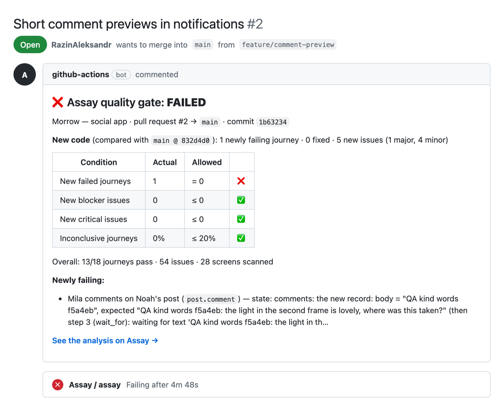
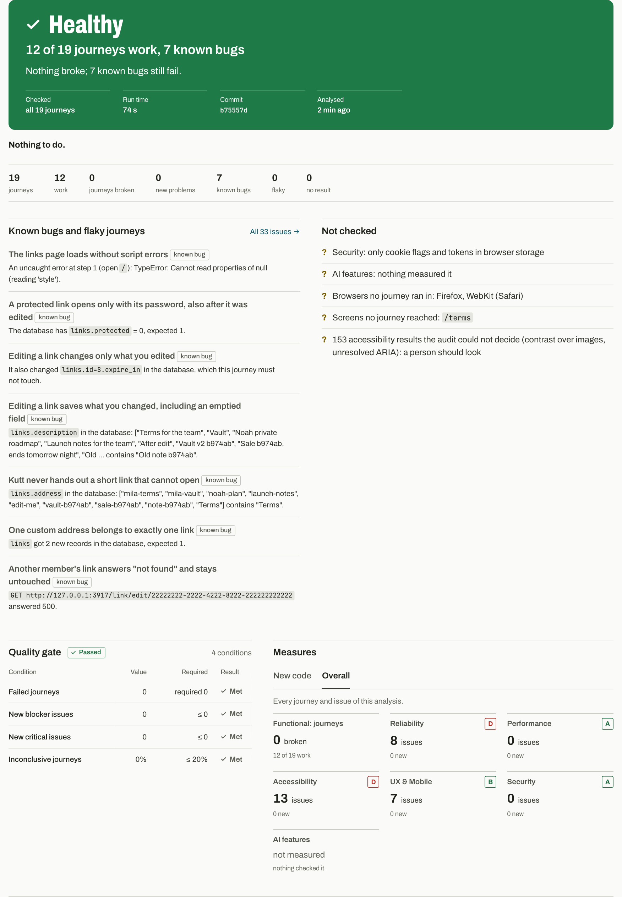

<h1 align="center">Assay</h1>

<p align="center">
  <b>End-to-end testing and LLM benchmarking for your product, run by your own Claude.</b><br>
  SonarQube reads your code. Assay runs your product: it walks through it like a person in a real browser and checks
  what actually got saved. Every pull request gets a verdict with the evidence. Free and open source.
</p>

<p align="center">
  <a href="https://github.com/RazinAleksandr/assay/actions/workflows/ci.yml"></a>
  
  
  <a href="LICENSE"></a>
</p>

<p align="center">
  <a href="#one-prompt-four-ways-to-use-it">What you get</a> ·
  <a href="#quick-start-hosted-service">Quick start</a> ·
  <a href="#how-it-works">How it works</a> ·
  <a href="docs/AUTHORING.md">Writing journeys</a> ·
  <a href="#self-hosting">Self-hosting</a> ·
  <a href="#development">Development</a>
</p>

<p align="center">
  
  <br><sub>A real pull request in <a href="#real-apps">Morrow</a>, a social app. The change cut every new comment to
  20 characters. Every request returned 200 and the screen looked fine; Assay read the database, found the short row
  and blocked the merge.</sub>
</p>

---

## What it catches

Silent data breakage: everything returned 200, nothing threw, the screen looks right, and the wrong thing got saved.
Error trackers miss it (no exception), screenshot tests miss it (the screen is fine), and coding agents miss it (they
check their work by looking at the page). Assay reads the app's real state before and after every user journey, so it
sees the 20-character comment in the database and points at the line of the pull request that wrote it.

On top of that, every screen it visits is scanned for console errors, failed requests, Core Web Vitals, WCAG 2.2 AA
(axe-core), layout overflow, touch targets, broken images and tokens left in storage.

## One prompt, four ways to use it

Assay is a harness for the Claude you already have. `/assay:connect` in Claude Code studies your product (what it is,
how it runs, where its data lives, its AI features, what would hurt users most) and writes that down in
`.assay/product.md`; every later step adapts to it. Then it writes 5-10 journeys and proves them on the running app,
proves that they catch silent data bugs planted on purpose, adds a benchmark if the product uses a model, adds CI and
opens a pull request. From then on:

| | Ask Claude | What happens |
|---|---|---|
| **Test the product now** | *"run the Assay journeys"* | every journey and screen, a verdict and what is broken in words, locally |
| **Every pull request** | nothing; *"fix the Assay gate"* when it fails | CI runs the journeys the change can break; only new, reproduced problems block; `/assay:fix` fixes from the brief |
| **Benchmark the AI** | *"is haiku good enough for the drafts?"* | the AI features through the product over a dataset, arms compared with intervals ([below](#benchmarks-for-ai-features)) |
| **Agentic freedom test** | *"explore the checkout and find bugs"* | Claude uses the product freely while Assay shows it what changed in the data after every action; every bug is confirmed and kept as a journey ([below](#agentic-freedom-test)) |

The AI work runs on your Claude (subscription or key); Assay itself calls no model in the gate. The hosted service is
free, and you can run all of it yourself.

## Two ways to run it

This repository is the whole product: the scanner, the server, the GitHub Action and the Claude Code plugin.

| | **Hosted service** | **Self-hosted** |
|---|---|---|
| What you run | nothing: the maintainer runs a public instance at [`http://46.225.104.43:8080`](http://46.225.104.43:8080) | `assay server` on your machine (one Docker container) |
| How you connect | the Claude Code plugin (`/assay:connect`) or one step in GitHub Actions | the same action with `host-url: <your server>`, or any CI with a token |
| Accounts | none to create: GitHub signs the CI job in (OIDC), the first analysis creates the project | the same GitHub sign-in, plus email, Google or GitHub accounts if you configure them |
| Where your data lives | analyses (verdicts, steps, screenshots) on the public instance | only on your machines |

Either way the app runs inside **your** CI job; the server only receives the results ([what exactly](#what-leaves-your-ci)).
Without any server, Assay still works: `assay run` and `assay ci` apply the same gate locally and keep the reports in
the job's artifacts.

## Quick start (hosted service)

### With Claude Code

In your app's repository:

```
/plugin marketplace add RazinAleksandr/assay
/plugin install assay@assay
/assay:connect
```

Claude studies the product, writes 5-10 user journeys, proves each one on the running app, adds the GitHub Actions
workflow and opens a pull request. Its first CI run creates your project on the service. 30-45 minutes, without you.

From then on, ask in plain words: *"add a journey for checkout"*, *"why did the Assay gate fail?"*,
*"benchmark the assistant on the cheaper model"*, *"explore the admin page"*. The plugin ships five skills (`connect`,
`assay`, `fix`, `bench`, `explore`) and the `assay` MCP server.

### By hand

1. Describe the app: `uvx --from git+https://github.com/RazinAleksandr/assay@v0 assay init` writes
   `.assay/assay.yaml`, a smoke journey and the workflow below. Edit them following [the format](docs/AUTHORING.md).
2. Add the step:

```yaml
# .github/workflows/assay.yml
on: {push: {branches: [main]}, pull_request: {}}
jobs:
  assay:
    runs-on: ubuntu-latest
    permissions: {contents: read, pull-requests: write, id-token: write}   # id-token: the sign-in to Assay
    steps:
      - uses: actions/checkout@v4
      - run: npm ci                          # install (and build) the app as your other jobs do
      - uses: RazinAleksandr/assay@v0
        # with:
        #   anthropic-api-key: ${{ secrets.ANTHROPIC_API_KEY }}   # AI-judge checks; without it they stay undecided
```

Prerequisites: [uv](https://docs.astral.sh/uv/) on your machine (the plugin and `uvx` use it); on CI the action
installs everything itself.

## How it works

```
pull request ─► start the app ─► walk the journeys in Chromium / WebKit ─► read the app's real state
            ─► compare with the last analysis of main ─► gate + comment on the PR ─► evidence on the server
```

A **journey** is what a person does, in a few lines of YAML, plus what must be true afterwards:

```yaml
- id: comment.add
  title: Mila comments on Noah's post
  promise: A comment is saved in full          # what users are promised; people read this instead of the id
  as: mila
  steps:
    - goto: /p/1
    - fill: {label: Add a comment, value: "Lovely light in this one, where was it taken?"}
    - click: {role: button, name: Post}
  must:
    - state: {comments: {delta: 1, contains: {body: "Lovely light in this one, where was it taken?"}}}
    - allowed_changes: [comments, notifications]     # anything else that changes in the data is a bug
    - no_errors: true
```

- **Steps find elements the way people see them** (role, label, text), so journeys survive CSS refactors.
- **Checks read the app's state** through probes declared once in `.assay/assay.yaml`: a SQLite or Postgres query, an
  HTTP endpoint, JavaScript in the page (localStorage, IndexedDB, canvas pixels, game state), files, or any shell
  command that prints JSON. `allowed_changes` catches side effects nobody wrote an assertion for.
- **An app that cannot start in CI** (a GPU, devices, a large backend, paid services) is tested where it is hosted:
  staging, a pull request's preview or a self-hosted runner on the machine
  ([how](docs/AUTHORING.md#testing-a-deployed-app-staging-preview-special-hardware)).
- **Facts by code, meaning by the judge.** Code decides everything it can; an LLM judge (Claude) decides only what code
  cannot, sees the screenshot, votes three times on `must` items and says `cannot_tell` instead of guessing.
- **Describe the goal instead of the steps** if you prefer: `goal: Mila sends Leo a message` is walked once by an AI
  agent, its path is cached in `.assay-cache/`, and CI replays it without a model.

The full format (profile, probes, steps, checks, matchers, the gate) is in [docs/AUTHORING.md](docs/AUTHORING.md).

### The rules of the gate

| | |
|---|---|
| **Only what the change breaks blocks** | each analysis is compared with the last analysis of the target branch, like SonarQube's "new code" |
| **The first analysis is the baseline** | when a branch has no analysis yet, the problems the product already has are listed and block nothing; failing journeys still do. A pull request into such a branch blocks nothing; a server that cannot be reached counts every finding |
| **A failure must reproduce** | a journey whose failure would block runs once more from a fresh app; if it passes then, it is flaky: listed in the comment, never blocking (`gate.confirm`) |
| **A broken environment is never a failure** | app down, login failed, no judge key: the verdict is ⚠️ *Not sure* (inconclusive) with an owner (environment, journey, judge), never ❌ |
| **It fails closed** | no journeys executed, an unmeasured quality, too many inconclusive journeys: never ✅ |
| **Only the journeys a change can touch run** | the journey map of `main` (frontend files that ran, API routes, tables, texts) picks them; critical ones and a rotating 10 % sample always run ([`assay/select.py`](assay/select.py)) |
| **Agents cannot game it** | a change that removes or softens checks blocks until a person adds the label `assay-approved` ([`assay/guard.py`](assay/guard.py)) |
| **Known bugs never block** | a journey tagged `known-bug` is an expected failure while it fails the same way; when the fix lands, the comment says so |

## What a pull request gets

```
❌ Don't ship: 1 journey broke
Mila comments on a post: `comments.body` was saved cut short in the database: 20 of 90 characters.
From you: nothing, your agent can fix it from the brief.  Evidence →  Brief for agents
Checked 12 of 140 journeys (touched by this change) · 3 min · compared with main @ 1b63234
```

- **A verdict a person reads in five seconds:** ✅ Ship it, ❌ Don't ship or ⚠️ Not sure, one sentence built from what
  the app actually saved (templates in [`assay/explain.py`](assay/explain.py), no model: a phrase that lied once would
  ruin the gate), what the person must do and how much was checked.
- **The evidence page:** the screens on `main` and in the change side by side, the saved values against the expected
  ones, every step.
- **Product health** for each branch: journeys kept and broken, flaky ones, and an explicit list of what is *not*
  checked.
- **The SonarQube structure underneath:** the quality gate with each condition, its value and threshold; measures per
  quality (functional, reliability, performance, accessibility, UX, security, AI) for **new code** and **overall**, with
  A-E ratings; an **Issues** page with facets (quality, severity, new or existing, rule, screen, journey); history per
  branch and pull request.
- **A brief for coding agents** (JSON, about 4 000 tokens): every failure with expected against saved values, the hunks
  of the change ranked by the data that went wrong ([`assay/code.py`](assay/code.py)) and how to reproduce it.

<p align="center">
  
  <br><sub>Kutt on the Assay server after one exploration: every journey works except the known bugs the exploration
  found, each named by what the data showed (<code>links.protected = 0, expected 1</code>); below, the quality gate and
  the measures.</sub>
</p>

### Fix it with your agent

In Claude Code, `/assay:fix <brief link>` reads the brief, opens the suspect code, reproduces the failure, fixes the
product and re-runs the journeys until the verdict is ✅. Other agents (Codex, Cursor, Copilot) use the MCP server
`assay mcp` with the tools `assay_status`, `assay_brief`, `assay_run` and `assay_artifact`, or `assay brief <link>` for
the same JSON.

## Benchmarks for AI features

A model answers differently every time, so one green run proves little, and an answer can read well while the feature
fails. Assay benchmarks an AI feature **through the product**: the journey checks what the feature did (the record it
created, the facts in its answer, one judge criterion per item), over a dataset of real inputs, repeated, on every
**arm** you compare (two models, two prompts, two builds).

```yaml
# .assay/cases/assistant.yaml: one journey, one row per ticket (fixtures/tickets.yaml)
- id: ai.draft
  title: The AI drafts a reply to {row.ticket} that follows the store's policy
  ai: true
  each: fixtures/tickets.yaml          # {id: refund-on-day-29, ticket: T-1009, category: "^(refund|warranty)$", expect: "…"}
  steps:
    - goto: /?t={row.ticket}
    - click: {role: button, name: Draft reply with AI}
  must:
    - state: {"tickets.{row.ticket}.draft.category": {regex: "{row.category}"}}
    - judge: "{row.expect}"
    - allowed_changes: ["tickets.{row.ticket}.draft"]

# .assay/assay.yaml
bench:
  attempts: 3
  arms: {sonnet: "env:ASSISTANT_MODEL=sonnet", haiku: "env:ASSISTANT_MODEL=haiku"}   # the first is the baseline
```

`assay bench .assay` (or `/assay:bench`, or `command: bench` in the action, weekly in CI) gives each arm a pass rate with
its 95 % interval, pass^k (the share of rows that passed every attempt: what users feel), the difference from the
baseline marked ✱ only when its interval excludes zero, the rows that flip and the median journey and answer time. An
arm is the same app started with other settings (`env:KEY=VALUE`), another checkout (a folder) or a running build (a
URL); with no arms the baseline runs twice, the noise floor of your gate.

<p align="center">
  
  <br><sub>A real benchmark of <a href="#real-apps">Relay</a>, a support inbox whose assistant is Claude. Over 11 tickets,
  Haiku refused a refund the customer was owed on the ticket whose order was 29 days old, in every attempt: it counted
  the days wrong. On average the gap is within chance; the per-row view shows where it is not.</sub>
</p>

## Agentic freedom test

Journeys check what someone thought to write down. `/assay:explore` lets Claude loose on the product with a charter
("explore comments with long and multilingual text to find text saved differently from what was typed"), through a
browser Assay runs. After every action Claude gets the page, and what a screen never shows:

```
data     ~ comments id=7: body "QA kind words: the light in the second frame is lovely" → "QA kind words: the li"
errors   console: TypeError: Cannot read properties of null (reading 'style')
calls    POST /api/comments → 201
```

So it notices a comment saved cut short while the screen says "Saved". It works through tours (the main path, hostile
inputs, interruptions, another account, a phone screen) inside a budget the server enforces (60 steps, 20 minutes by
default), and notes findings at the step they came from. A finding is reported as a bug only once it reproduces: Claude
writes it as a journey and keeps it, tagged `known-bug`, when it fails twice on a fresh app. It never blocks while the
bug is there and turns green the day it is fixed. Explorations run on demand, never on every pull request.

Any agent can use the same browser through the MCP server: `assay_explore_start`, `assay_explore_act`,
`assay_explore_note`, `assay_explore_finish` ([details](docs/AUTHORING.md#6-agentic-freedom-test-explore)).

## Self-hosting

Everything the hosted service runs is in this repository. The server is a single Python process with SQLite and a
folder per analysis; it needs no browsers (those run in CI).

### 1. Start the server

```bash
git clone https://github.com/RazinAleksandr/assay && cd assay
docker build -t assay-server -f deploy/Dockerfile.server .
docker run -d --name assay-server --restart unless-stopped -p 8080:8080 -v assay-data:/data \
  assay-server --public-url https://assay.example.com --config /data/server.yaml
```

Or without Docker: `uvx --from git+https://github.com/RazinAleksandr/assay@v0 assay server --data ./assay-data
--host 0.0.0.0 --port 8080 --public-url https://assay.example.com`.

On first start the server writes an admin token to `<data>/token` (or takes `ASSAY_SERVER_TOKEN`). The token signs
you in at `/login` and lets CI systems other than GitHub upload.

`--public-url` is the address CI and browsers use. It turns on the GitHub Actions sign-in: a job asks GitHub for a
token whose audience is the action's `host-url`, so the two must be the same string.

### 2. Point CI at it

GitHub Actions, no secrets needed:

```yaml
- uses: RazinAleksandr/assay@v0
  with:
    host-url: https://assay.example.com
```

With the Claude Code plugin, tell Claude the server URL when you run `/assay:connect`, or add `host-url` to the
workflow it writes.

GitLab CI and anything else: give the job `ASSAY_HOST_URL` and `ASSAY_TOKEN` (the admin token) and run `assay ci`.
For GitLab there is a ready [template](ci/assay.gitlab-ci.yml) built on the scanner image from the root
[`Dockerfile`](Dockerfile) (Playwright browsers, Node 22, `assay`):

```bash
docker build -t assay .
docker run --rm -v "$PWD:/src" -w /src -e ASSAY_HOST_URL -e ASSAY_TOKEN assay ci
```

### 3. Configure it (optional): `server.yaml`

Keep it in the data folder, never in git.

```yaml
admin: {user: admin, password: "<hash>"}       # `assay hash-password` prints the hash; sign in at /login
admins: [you@example.com]                      # verified emails that see every project

auth:                                          # people sign up with email and password, Google or GitHub
  google: {client_id: "….apps.googleusercontent.com", client_secret: "…"}   # redirect URI: <public url>/auth/google/callback
  github: {client_id: "…", client_secret: "…"}                              # redirect URI: <public url>/auth/github/callback
  signup: true                                 # false: only Google and GitHub create accounts
smtp: {host: smtp.example.com, port: 587, user: "…", password: "…", from: "Assay <no-reply@example.com>"}

gate: {max_new: {blocker: 0, critical: 0}}     # a gate for every project …
projects: {gh/acme/shop: {gate: {min_rating: {reliability: B}}}}   # … or per project
public: [gh/acme/docs]                         # projects shown to everyone whatever their repository's visibility
trusted_proxy: true                            # behind your reverse proxy: take the client address from X-Forwarded-For
oidc_audiences: [https://assay.internal]       # more addresses CI may sign in to besides --public-url
```

Without `smtp`, accounts work but emails are not confirmed and a forgotten password cannot be reset by a link. Google
accepts OAuth redirects only on https with a domain name.

**Who sees what.** Projects of public repositories are public, like their code. A private repository's project opens
only through the link CI posts in its pull requests (the link carries a view key once; the server keeps it in a
cookie). A signed-in person also sees the projects of their own GitHub account.

### 4. Deploy and update

- `deploy/deploy.sh <ssh-host> <dir> <public-url>` ships the tracked files to a Linux box with Docker over SSH and runs
  `deploy/install.sh` there: build the image, replace the container, wait for `/api/health`. Data stays in `<dir>/data`.
- The hosted service deploys itself the same way: [`.github/workflows/deploy.yml`](.github/workflows/deploy.yml) runs on
  a self-hosted runner on the server after every green CI run on `main` (no SSH keys in GitHub) and moves the tag `v0`.
  Copy it if you want the same for your fork.
- A status badge for your README: `<server>/api/projects/<key>/badge.svg?branch=main`.

## What leaves your CI

The app runs inside your own CI job. The server receives the run folder: verdicts, the steps of each journey,
screenshots of your app's screens, the data values the checks compared, the issues found, the app's log and, on a pull
request, the change's diff (Assay ranks the suspect hunks from it). The rest of your repository stays in the job. If
that is too much to send to the public instance, run your own server.

## Command line

```bash
assay init [--ci github|gitlab]          # add .assay/ and the CI step to an app repository
assay browsers [--with-deps] [chromium webkit]   # download the browsers the scanner drives (once per machine)
assay doctor .assay                      # preflight: start command, accounts, probes, judge, browsers
assay run .assay [--scan] [--confirm] [-k 'post.*' | -k tag:smoke | -k group:feed | -k is:critical]   # same gate as CI
assay scan --url http://localhost:3000   # no config at all: crawl any URL and scan every screen
assay grade .assay .assay/runs/<id>      # re-grade recorded evidence without re-running the app
assay brief [<analysis URL> | .assay/runs/<id>] [--case ID --full]   # what an agent needs to fix the gate (JSON)
assay mcp                                # the same for agents over MCP (stdio), plus the explore browser
assay bench .assay [--attempts 3] [--arm name=env:K=V | name=<folder> | name=<url>]   # repeat and compare (default: bench: in assay.yaml)
assay ci                                 # the CI step: run, compare with the target branch, upload, comment, gate
assay upload .assay/runs/<id> --branch main   # upload an existing run as an analysis
assay report <run> --embed -o report.html     # one self-contained HTML file to share
assay portfolio <project>... -o portfolio.html   # one page over several apps
assay server --data ./assay-data [--public-url URL] [--config server.yaml]
assay hash-password                      # the admin password hash for server.yaml
```

Exit codes: `0` passed · `1` failed · `2` inconclusive (the environment: retry, don't blame the change) · `3`
configuration error.

| Environment variable | Used by | Meaning |
|---|---|---|
| `ASSAY_HOST_URL` | `ci`, `bench` | the server to upload to; unset: a local analysis, reports stay in the job's artifacts |
| `ASSAY_TOKEN` | `ci`, `bench`, `upload` | the server's admin token (CI other than GitHub Actions) |
| `ASSAY_PROJECT_KEY` | `ci`, `bench` | the project key outside GitHub (on GitHub it is `gh/<owner>/<repo>`) |
| `ANTHROPIC_API_KEY` | judge, goal agent | Claude through the API; locally a logged-in Claude Code CLI works without a key |
| `ASSAY_JUDGE` | judge | override the profile's judge backend: `claude-cli`, `anthropic` or `none` |
| `GITHUB_TOKEN` / `ASSAY_GITLAB_TOKEN` | `ci` | to post the pull request / merge request comment |
| `ASSAY_SERVER_TOKEN` | `server` | the admin token (default: generated into `<data>/token`) |

## Real apps

Three working apps connected the way users connect theirs. Morrow and Folio have bugs that were reproduced by hand
first and then written down as journeys; Relay has an AI assistant. Numbers are from their last analyses of `main` in CI.

| App | What it is | Journeys | Result | Known bugs found | Job |
|---|---|---|---|---|---|
| **Morrow** | social network: feed, posts, messages, moderation · React, Express, SQLite | 18 | 14 pass · 4 fail | 4 of 4 | 4 min |
| **Folio** | drawing studio: canvas, layers, masks, export, offline · React, IndexedDB | 18 | 10 pass · 7 fail · 1 inconclusive | 7 of 7 | 4 min |
| **Relay** | support inbox with an AI assistant (Claude) · Node | 12 | 12 pass | — | 3.5 min |

Every failure in Morrow and Folio is a known bug, such as *Delete with nothing selected erases the whole layer* (caught
in the canvas pixels) or *searching for "%" lists every account* (caught in the API response). No journey failed by
mistake. The inconclusive one needs the AI judge, and those runs had no model key.

**An app we did not write.** [Kutt](https://github.com/thedevs-network/kutt), the open-source URL shortener, connected
by `/assay:connect` in a Claude Code session nobody touched: it worked out that Kutt does not count visits from a
headless browser, gave the journeys that open short links a normal user agent, and kept 10 journeys proven twice. One
`/assay:explore` session (three charters, 81 steps) then found six bugs, each confirmed by a journey that fails twice
on a fresh app. The worst: **editing a protected link through the documented API removes its password**, so the link
opens for anyone; the API answered 200 and the screen said "updated", and only the data (`protected 1 → 0`) showed it.
Others: an edit moves a link's expiry 12 hours early, a reserved word with a capital letter is accepted as an address
that never redirects, two simultaneous creates save the same address twice.

## Why not just Playwright tests?

| | Playwright / Cypress tests | **Assay** |
|---|---|---|
| What decides pass/fail | assertions someone wrote on the page | the app's data before and after, plus every screen's sensors |
| Unexpected side effects | unnoticed | `allowed_changes`: anything else that changed fails the journey |
| A flaky environment | red build | inconclusive, with an owner: product, journey, environment or judge |
| Pull requests | everything that fails blocks | only what the pull request broke blocks |
| Where results live | CI logs | a server with history per branch and pull request |

Assay drives Playwright underneath; it adds the state oracle, the gate and the history around it.

## Repository layout

| Path | What |
|---|---|
| [`assay/`](assay) | the engine and the CLI: driver, probes, sensors, checks, judge, goal agent, grading, selection, brief, MCP, the explore session ([`explore.py`](assay/explore.py)) |
| [`assay/server.py`](assay/server.py), [`assay/web/`](assay/web) | the server: API for CI, accounts, the pages people and agents read |
| [`action.yml`](action.yml) | the GitHub Action (`uses: RazinAleksandr/assay@v0`); uv builds the scanner from this repository |
| [`.claude-plugin/`](.claude-plugin), [`skills/`](skills), [`bin/`](bin) | the Claude Code plugin and its marketplace: `/assay:connect`, `/assay:explore`, `/assay:bench`, `/assay:fix`, the `assay` skill and the MCP server |
| [`ci/`](ci), [`Dockerfile`](Dockerfile) | the GitLab template and the scanner image for CI other than GitHub |
| [`deploy/`](deploy) | the server image and the scripts that install it on a machine |
| [`docs/`](docs) | [the journey and profile format](docs/AUTHORING.md), screenshots |
| [`examples/hello/`](examples/hello) | the smallest complete project; this repository's CI runs it through the action |
| [`tests/`](tests) | unit and integration tests |

## Development

```bash
uv sync                                   # Python 3.11+, installs the engine in .venv
uv run pytest -q                          # the test suite (about 30 s)
uv run assay browsers                     # Chromium for the driver, once per machine
uv run assay run examples/hello/.assay --scan            # a full local run against the example app
uv run assay server --data /tmp/assay-data --port 9000   # the server on http://127.0.0.1:9000
```

Try your change to the plugin without publishing it: `claude --plugin-dir .` in an app's repository.

**CI and releases.** [`ci.yml`](.github/workflows/ci.yml) runs the tests, then the action from this checkout
(`uses: ./`) on a clean runner against `examples/hello`. After a green run on `main`,
[`deploy.yml`](.github/workflows/deploy.yml) updates the hosted service and moves the tag `v0`, so the action users run,
the plugin they install (from `main`) and the server they upload to always come from the same commit. The tag `v1`
(the 1.0 release) is moved by hand.

## License

[Apache-2.0](LICENSE). Bundled third-party files keep their own licenses: axe-core (MPL-2.0,
[`assay/assets/axe-LICENSE.txt`](assay/assets/axe-LICENSE.txt)), the Archivo and JetBrains Mono fonts (SIL OFL 1.1,
[`assay/web/static/`](assay/web/static)).
